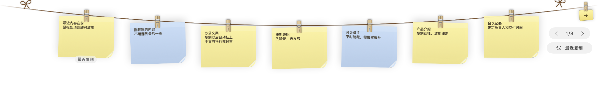
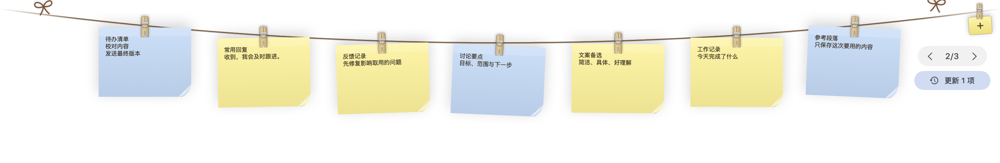

  

<h1 align="center">Snapline AutoText</h1>

<strong>把临时要用的文字和图片，挂在手边。</strong>

macOS 14+ · Apple Silicon 与 Intel · 免费开源

  <a href="https://github.com/w88856678-rgb/snapline-auto-text/releases/download/v1.6.7/Snapline-AutoText-1.6.7.dmg"><strong>下载 Mac 版 · 1.6.7</strong></a>
  &nbsp;·&nbsp;
  <a href="docs/usage.zh-CN.md">使用指南</a>
  &nbsp;·&nbsp;
  <a href="https://github.com/w88856678-rgb/snapline-auto-text/releases/latest">其他下载与版本更新</a>

查资料时复制了几段文字，写文档时又需要刚才的截图——Snapline AutoText 把这些临时材料放在屏幕顶部的一条晾衣绳上。复制文字就会生成便签，需要时展开取用，用完后自动收起。

界面示例由实际应用组件渲染，内容为虚构演示素材。

## 让复制过的内容，接着用起来

| 日常要做的事 | Snapline AutoText 怎么帮你 |
| --- | --- |
| **收集几段资料** | 正常按 ⌘C，文字自动变成便签，不用逐条新建。 |
| **把原文用到聊天或文档里** | 单击文字便签复制，再按 ⌘V 粘贴。取回完整文字、换行和 emoji，便签不会变成一张图片。 |
| **把图文放在一起参考** | 文字便签与截图、图片共用一个挂架，方便写作、对照和临时整理。 |
| **找刚刚复制的那一项** | 最近内容排在前面；“最近复制”入口和卡片标签帮助你快速定位。 |
| **翻旧内容时继续复制** | 当前页和眼前的卡片保持原位，新内容显示为“更新 N 项”，由你决定何时查看。 |
| **用完继续办公** | 鼠标移开后自动收起；再次展开会记住浏览位置。 |

## 三步开始使用

1. **复制**：在网页、文档或聊天窗口复制文字，它会自动挂成便签。
2. **找到**：将鼠标停在屏幕顶部区域展开挂架，找到需要的内容。
3. **粘贴**：单击文字便签，在目标应用按 ⌘V，继续写下去。

双击便签可以编辑全文，右键可以固定常用内容。图片剪贴板捕获需在设置中开启 **Catch clipboard captures**。

## 20 项临时工作区，翻找时保持顺手

文字与图片共享 20 项常规容量，分页展示，保留卡片原来的大小。使用箭头、鼠标滚轮或触控板横向滚动，就能查看更早的内容。

正在查看旧内容时，新复制项只提示更新，不会强制跳页或挤走眼前的卡片。想看最新内容，再点击“更新 N 项”；普通收起后重新展开，仍回到刚才的位置。

浏览旧内容时保留当前页，点击更新提示再查看最近复制的卡片。图中为演示素材。

## 下载与安装

支持 **macOS 14 及以上**，同一个安装包适用于 **Apple Silicon 和 Intel Mac**。

1. [下载 DMG 安装包](https://github.com/w88856678-rgb/snapline-auto-text/releases/download/v1.6.7/Snapline-AutoText-1.6.7.dmg)。更新前先退出旧版 Snapline。
2. 打开安装包，将 **Snapline.app** 拖入 **Applications（应用程序）**，再打开应用。
3. 在菜单栏确认 **“复制文字自动挂上 / Auto-hang copied text”** 已开启，然后复制一段文字试试。

当前发行版尚未经过 Apple 公证。首次打开若被 macOS 拦截，可在 **系统设置 → 隐私与安全性** 中允许打开；若系统询问剪贴板访问权限，允许后再复制文字。

## 你可能关心

**长文字能完整保存吗？**

可以。卡片上显示预览，单击复制得到全文，双击可以查看和编辑。

**20 项满了会怎样？**

会优先取下较早、未固定且不在当前浏览页的卡片，取下不会删除原文件。固定项和浏览中的内容受到保护，必要时会临时多保留一项。这是当前任务的临时工作区，不是完整的可搜索剪贴板历史。

**内容保存在哪里？可以暂停吗？**

便签和图片保存在 Mac 本机。可以在菜单栏关闭文字自动捕获；重新开启后，只收集之后新复制的内容。[查看数据与设置说明](docs/usage.zh-CN.md#安装数据与权限)。

**展开时会遮住页面吗？**

展开的挂架会覆盖页面顶部区域。目前采用顶部悬停展开、移开自动收起的方式；收起时复制新内容也会短暂展开提示。可以用 **Control + Option + T** 切换显示或隐藏，具体快捷键以菜单栏显示为准。

**可以把文字直接拖进其他应用吗？**

文字便签提供纯文字拖拽格式，但跨应用拖拽兼容性仍待实机验证。日常推荐使用“单击便签 → 在目标应用按 ⌘V”的取用方式。

## 了解更多

- [使用指南](docs/usage.zh-CN.md)：图文收集、翻页、固定内容、自动隐藏与数据管理。
- [版本更新](CHANGELOG.md)：每次更新带来的变化。
- [开发与验证](docs/development.zh-CN.md)：构建、测试、CI 与已验证的范围。

Snapline AutoText 是基于 [Snapline v1.6.2](https://github.com/mohabujubara/snapline/tree/v1.6.2) 的非官方 macOS 定制版，设计与实现源自 [Tendedero](https://github.com/alejandrobujan/tendedero)。感谢原作者与贡献者；项目按 [MIT 许可证](LICENSE) 开源，保留原有版权声明及[上游介绍](README.upstream.md)。当前定制版仅面向 macOS，仓库中的 Windows 源码供参考。
